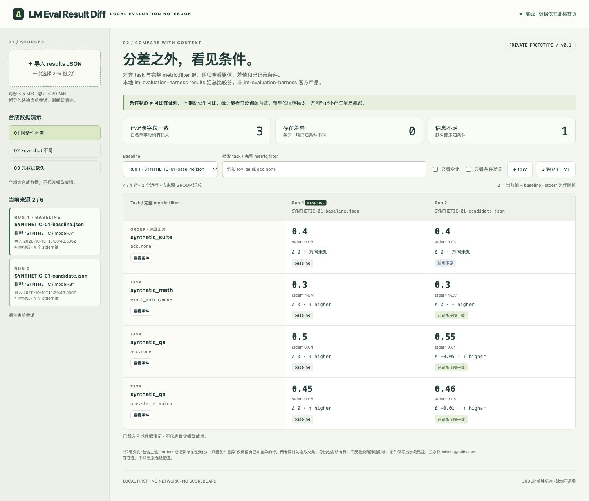

# LM Eval Result Diff v0.1

一个无依赖的 lm-evaluation-harness **results 汇总 JSON 比较器**。只读已有结果，不运行模型、不调用评测服务。源码、文档和原创合成示例采用 MIT 许可。

**非 EleutherAI / lm-evaluation-harness 官方产品，未获其背书。** 原工作名 EvalDiff；与同名 PyPI 包无关联。内部 `globalThis.EvalDiff` 和 `format: "EvalDiff report v1"` 保留兼容性。

[下载源码 ZIP](https://github.com/tryu-ai/lm-eval-result-diff/archive/refs/heads/main.zip) · [下载单文件 HTML](https://raw.githubusercontent.com/tryu-ai/lm-eval-result-diff/main/lm-eval-result-diff.html)（保存到本机）



## 打开与使用

1. 尝试双击 `dist/index.html`（仓库根目录也有同字节副本 [lm-eval-result-diff.html](lm-eval-result-diff.html)）。HTML 内含全部 JS/CSS/演示数据，没有模块加载或远程依赖。
2. 如果浏览器限制本地文件，使用 Python 3 在此目录运行：

   ```sh
   python3 -m http.server 4183 --bind 127.0.0.1 --directory dist
   ```

   打开 `http://127.0.0.1:4183/index.html`。结束后在终端按 Ctrl-C。
3. 一次选择 2–6 份 results JSON。每次成功导入替换整个会话；导入失败保留原会话。取消选择不改变会话。
4. 选择 baseline，检索 task 或完整键；“只看变化”筛选主值、stderr 或存在性变化，“只看条件差异”筛选有已知条件差异的行。两者取交集。
5. “查看条件”在本地展开逐字段证据。CSV 与独立 HTML **始终导出全量行**，不受页面筛选影响。HTML 报告无脚本，可单独保存查看。

已验证 Mac Edge 的 localhost 加载、标签页模拟离线时本地导入和 CSV/HTML 下载。`file:` 直接双击、物理断网及其他浏览器未验证。

## 官方结构依据（2026-10-15 核验）

读取了官方 main 的原始文件，按实际字段实现：

- [lm_eval/result_schema.py](https://github.com/EleutherAI/lm-evaluation-harness/blob/main/lm_eval/result_schema.py)：`EvalResults` 的可选字段、`results`/`groups`、`_TaskMetrics`、`_SampleCount`、`_EvalConfig`。
- [docs/interface.md](https://github.com/EleutherAI/lm-evaluation-harness/blob/main/docs/interface.md)：few-shot、generation、chat/system、四类 seed 和结果输出选项。
- [docs/task_guide.md](https://github.com/EleutherAI/lm-evaluation-harness/blob/main/docs/task_guide.md)：dataset/split、prompt、filter 与 generation 的任务配置键。

这是对读取时 main 的支持范围，不是所有历史版本/未来版本的通用验证器；上游 main 可能变化。本次未固定上游 commit，也未安装/执行 harness。`configs` 是任务配置映射，不从 CLI 旗标名称臆造 JSON 字段。默认值不会补入缺失记录。`samples_*.jsonl` 不支持。

## 比较与数学边界

- 行标识为 **scope (`results` 或 `groups`) + task 原始键 + 完整 `metric,filter` 键**。task alias 不参与对齐。以第一个逗号拆出 metric，后面的整个 filter 后缀原样保留；不同 filter 不合并。
- 动态指标必须有非空 `metric,filter` 形状。`name`、`alias`、`sample_len`、`sample_count` 不当主指标。metric 名以 `_stderr` 结束的键只作为伴随 stderr，绝不单独计分；没有匹配主指标的 stderr 不单独展示。
- `acc,none` 对应 `acc_stderr,none`，其他 filter 同理。stderr 原样显示，不相减、不合成置信区间、不做统计检验。
- `Δ = 当前运行数值 − baseline 数值`。只有两边都是有限的 JSON number 时计算，0 是有效数值。字符串（含 `"0.55"`、`"N/A"`）、null、bool、数组、对象都不转数值。主值或任务/指标缺失不补 0。
- 原始 JSON 值保留 JSON 类型（数值的词法写法如 `0.50`/`0.5` 不保留）。采用 JS 双精度浮点；分差显示和 CSV 采用 12 位有效数字消除二进制尾差，内部差值仍为原生浮点结果。大整数与极小差分受双精度限制，不是任意精度计算器。
- `higher_is_better` 按完整键优先、metric 名次之读取；只显示 ↑/↓/未知，各运行可不同。没有“全局赢家”、自创平均总分、排名、显著性或训练有效性判断。
- `groups` 用 GROUP 单独标记，展示来源已提供的汇总。即使 task 名相同，也与 `results` 分开。展示 `group_subtasks` 条件；不递归推断子任务汇总条件。缺 group 自身配置保持信息不足。支持观察 `sample_count[完整键]` 的组内指标样本数和 `sample_len`，不拿它们替代 `n-samples.effective`。

## 三态与白名单

对每个非 baseline 单元格相对 baseline：

- **存在差异**：在记录存在时，至少一项已知白名单条件值不同；允许同时仍有未知字段。
- **信息不足**：主记录缺失，或没有已知差异但至少一项条件缺失/未知。两边同样缺失仍不是“一致”。
- **已记录字段一致**：主记录存在，白名单字段均有记录且相同。只说明记录本身，不能证明评测公平可比。

页面顶部按行聚合候选状态（有差异优先，其次信息不足），数字不是“通过”的任务数。baseline 自身用 baseline 标签；独立报告保留其条件自比较状态。

核对的必查路径：

- task：`versions[task]`、`n-shot[task]`、`n-samples[task].effective`；出现时补充 `sample_len`、组内 `sample_count[metric,filter]` 和 `task_hashes[task]`。
- `configs[task]`：`dataset_path`、`dataset_name`、`dataset_kwargs`、`custom_dataset`、`training_split`、`validation_split`、`test_split`、`fewshot_split`、`process_docs`、`use_prompt`、`description`、`doc_to_text`、`doc_to_target`、`doc_to_choice`、`fewshot_delimiter`、`target_delimiter`、`gen_prefix`、`num_fewshot`、`output_type`、`generation_kwargs`、`repeats`、`filter_list`、`metric_list`、`should_decontaminate`、`doc_to_decontamination_query`。
- run：`git_hash`、`lm_eval_version`、`transformers_version`、`chat_template`、`chat_template_sha`、`system_instruction`、`system_instruction_sha`、`fewshot_as_multiturn`。
- `config`：`gen_kwargs`、`random_seed`、`numpy_seed`、`torch_seed`、`fewshot_seed`、`limit`、`model_dtype`、`model_revision`、`model_sha`。

对象属性顺序忽略，数组顺序和 JSON 类型保留；配置字符串不解析、不执行，函数名字符串不调用。可选配置的显式 null 被视为“记录了无此设置”，但缺失仍是未知。版本、few-shot、有效样本数、dataset_path 与运行版本字段的 null 是未知；版本/计数/dataset_path 有最小类型校验。`null` 与缺失的不同存在性在详情和导出中保留。不是完整 harness task-config 类型验证器。

模型名 (`model_name`，缺失时用 `config.model`) 和 provider 是正常标识，模型名字不同不会触发条件错误。模型 dtype/revision/SHA 可能触发条件差异；不从 `model_args` 猜模型名称或抽取设置。白名单以外的信息不会影响三态，结果可能仍有未被记录或未被检查的重要差别。

## 隐私与安全边界

- 浏览器中纯原生 HTML/JS/CSS，零 npm 依赖，无上传、遥测、CDN、fetch、WebSocket、eval、远程脚本、持久化 storage 或 Service Worker。CSP `connect-src 'none'` 限制页面连接。刷新/关闭标签页清空会话；浏览器下载的文件仍留在用户磁盘。
- 完整文件只在解析阶段短暂进入页面内存。归一化仅保留指标、身份和白名单路径；丢弃 `model_args`、`pretty_env_info`、`samples` 等非白名单内容。这里没有安全擦除内存的承诺，也不控制浏览器扩展、操作系统或崩溃转储。
- **导出白名单**：来源文件名（去路径、截断至 200 字符）、导入时间、报告时间、baseline、模型标识（HTML）、scope/task/完整指标键、原指标、原 stderr、Δ、方向、三态，以及条件**路径、状态和 `missing/null/value` 存在性**。HTML 可附合成来源标记。原始 prompt/filter/generation/dataset 配置值全部不导出，model_args/环境/样本不整包打入报告。CSV 每个 run/指标一行；条件状态序列置于单元格中。
- 这不是通用密钥清洗器：用户可在文件名、task、模型名或指标值中自行放入敏感文本，这些显示字段会进入报告，导出前需检查。条件路径含 task 名。不要将带秘密的真实结果上传给第三方。
- 页面数据经文本/HTML 转义；独立报告无脚本、无动态 JSON 注入。CSV 所有单元格引用并对公式前缀 `= + - @`、前导空白/BOM 和换行/Tab 做 apostrophe 防护。数值负差也按防护规则加前缀，表格软件可能将该单元格视为文本；未在 Excel/Numbers 内执行公式测试。
- 没有账户、服务端、协作、真实数据集、模型权重、付费资源、样本答案扩展或统计平台能力。

## 输入与资源限制

| 限制 | 值 |
|---|---:|
| 每批文件数 | 2–6 |
| 每份 / 每批文件字节 | 5 MiB / 20 MiB |
| JSON 嵌套深度 | 32 |
| 每份 JSON 值节点 | 100000 |
| 每份 task + group 数 | 500 |
| 每份 / 每批主指标记录 | 2000 / 2000（跨运行重复记录也计入） |
| 单个字符串 / 字段名 | 262144 / 1000 字符 |
| 表格分页 | 每页 50 行 |

导入前按文件大小检查；JSON.parse 前扫描深度，之后检查节点/结构/记录限制。非有限数（如 `1e999`）拒绝。限制减少资源风险，但不保证任何硬件上均无卡顿。浏览器解析在主线程进行。报告生成也受记录上限约束，没有做极限内存基准。JSON 重复属性遵循 JSON.parse 的最后一个属性规则，不是重复键审计器。

## 合成演示与测试

`fixtures/` 三组均标 **合成数据 — 非真实模型成绩**：

1. `SYNTHETIC-01-*`：记录条件相同，0.50 → 0.55；不同 filter 独立一行。
2. `SYNTHETIC-02-*`：0-shot vs 5-shot，并加入任务版本差异。
3. `SYNTHETIC-03-*`：刻意缺元数据、任务及 group；含 stderr null/缺失。

复现构建及测试（Node.js ≥18，无依赖安装）：

```sh
node tests/make-fixtures.cjs
node build.mjs
node --test tests/core.test.cjs
```

本次在 macOS、Node 26.0.0 和实际 Microsoft Edge 中验证。23 组自动测试通过。浏览器范围见 [验证记录](evidence/VALIDATION.md)。`tests/inputs` 为明确标注的非法/注入合成测试输入，不是演示成绩。超大输入临时生成，不打入交付包。

独立示例报告 [reports/lm-eval-result-diff-SYNTHETIC-report.html](reports/lm-eval-result-diff-SYNTHETIC-report.html) 和 CSV 为实际浏览器导出的原创合成示例。截图只含本原型及合成资料，拍摄于公开发布前。

未验证真实模型结果、所有 harness 历史版本、Safari/Firefox、Excel/Numbers、完整读屏器审计、实体手机、大规模浏览器性能、物理断网或 `file:` 双击。工具不执行模型评测或统计检验，不提供全局赢家。

## 源码结构

`src/core.js` 负责验证、对齐、状态和导出；`src/ui.js` 负责本地交互；`src/style.css` 与 `src/template.html` 为界面；`build.mjs` 内联生成 `dist/index.html`。构建可重复，不需服务端。原生源码和原创合成示例采用 [MIT License](LICENSE)。
